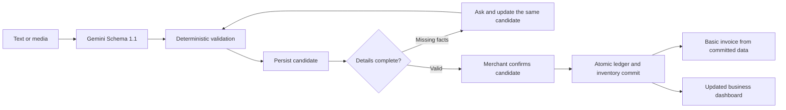

# Clandexis Invisible ERP

A conversational ERP demo for Indian textile MSMEs. Merchants describe a transaction in Telugu, Hindi, English, or mixed language. Gemini extracts Schema 1.1 candidates, deterministic validation checks the facts, and the merchant confirms before the ledger changes.

One approved WhatsApp sender phone maps to one independent merchant account. PostgreSQL supports the current local application. The Firestore backend remains available for existing environments and regression testing.

## Current status

| Area | Verified state |
| --- | --- |
| Authenticated dashboard | Running locally with PostgreSQL |
| Gemini extraction | Live text, clarification, and Telugu audio checked locally |
| Sale, repayment, stock addition | Implemented through the canonical ledger plans |
| Confirmation and isolation | Explicit confirmation, duplicate protection, and merchant isolation tested |
| Invoice | Basic PDF generated from a committed sale and downloaded locally |
| Cloud SQL | Cloud connection and application verification pending |
| Live WhatsApp | Subscription disabled following a deployment mismatch; corrected phone retest pending |

[Verification results](docs/TESTING.md) record what used real services and what used test doubles. [The incident record](docs/WHATSAPP_P0_INCIDENT.md) preserves the unresolved cloud investigation.

## Transaction flow



Query/report requests receive a read-only response. Missing prices and payment details require clarification. A candidate marked `ACCEPTED` still awaits confirmation. The committed transaction has `COMMITTED` status, and its candidate is marked `POSTED`.

## Run the local application

Use Python 3.11+, Node.js 20+, and PostgreSQL 17+. Run commands from this repository root, `team_clandexis`.

```bash
python3 -m venv .venv
.venv/bin/python -m pip install -r requirements-dev.txt
(cd dashboard && npm ci && npm run build)
```

Keep credentials in your existing ignored `.env` or process environment. `.env.example` lists configuration names. The runtime loads the repository `.env` when present and otherwise searches parent directories. The extractor uses `GEMINI_MODEL` and `GEMINI_FALLBACK_MODEL` for model selection.

On the prepared development Mac:

```bash
DATABASE_URL='postgresql://clandexis_app_test@127.0.0.1:55439/clandexis_demo' \
  PYTHONPATH=. .venv/bin/python scripts/run_postgres_demo.py
```

Open **http://127.0.0.1:8180/dashboard/** and sign in as **demo**. [DEMO.md](DEMO.md) provides the password-copy command, inputs, buttons, and expected balances. The launcher retains its account across restarts and disables Meta transport.

For another machine, prepare an empty database with [models/postgres_schema.sql](models/postgres_schema.sql) and follow [PostgreSQL setup](docs/POSTGRES_MIGRATION.md).

## Financial behavior

- All new merchant transactions require explicit candidate-specific confirmation.
- Clarification preserves the candidate, known buyer, items, quantities, and payments.
- Sale, receipts, credit, inventory movements, and journal entries commit atomically.
- Repayment reduces the customer's receivable while preserving sales and stock.
- Repeated confirmation returns the persisted result and has one posting effect.
- PDF generation follows the commit. A document failure leaves the committed sale intact.
- PDFs are explicitly labeled basic invoices. Tax compliance certification is outside the implemented service.
- PostgreSQL and Firestore are selected explicitly with `DATABASE_BACKEND`. Connection failures do not redirect writes to another backend.

Purchases, expenses, and other extracted financial intents remain held for review by the current ledger MVP.

## Code map

| Location | Responsibility |
| --- | --- |
| [app/schemas/transaction.py](app/schemas/transaction.py) | Runtime Schema 1.1 candidates |
| [app/pipeline.py](app/pipeline.py) | Input processing, Gemini extraction, validation |
| [app/services/validator.py](app/services/validator.py) | Deterministic financial validation |
| [agent-orchestrator/orchestrator.py](agent-orchestrator/orchestrator.py) | Reply routing, clarification, confirmation summaries |
| [app/services/persistence.py](app/services/persistence.py) | Backend selection |
| [app/services/postgres_ledger.py](app/services/postgres_ledger.py) | PostgreSQL persistence using canonical ledger plans |
| [app/services/ledger.py](app/services/ledger.py) | Canonical plans and Firestore implementation |
| [webhook-service](webhook-service) | FastAPI application and Meta adapter |
| [pdf_service](pdf_service) | Committed-sale PDF rendering and artifact storage |
| [dashboard](dashboard) | React/Vite dashboard |
| [tests](tests) | SQL, emulator, application, and security checks |

The tracked `webhook_service` and `agent_orchestrator` symlinks provide Python import names for the hyphenated directories. The earlier intent-format file `models/extraction_schema.json` remains a legacy reference; runtime Gemini output is defined by the Pydantic models in `app/schemas/transaction.py` and `app/services/interpreter.py`.

## Documentation

Start with the [documentation index](docs/README.md). It links the local demo, database setup, tests, security, WhatsApp flow, API contracts, and deployment requirements.
