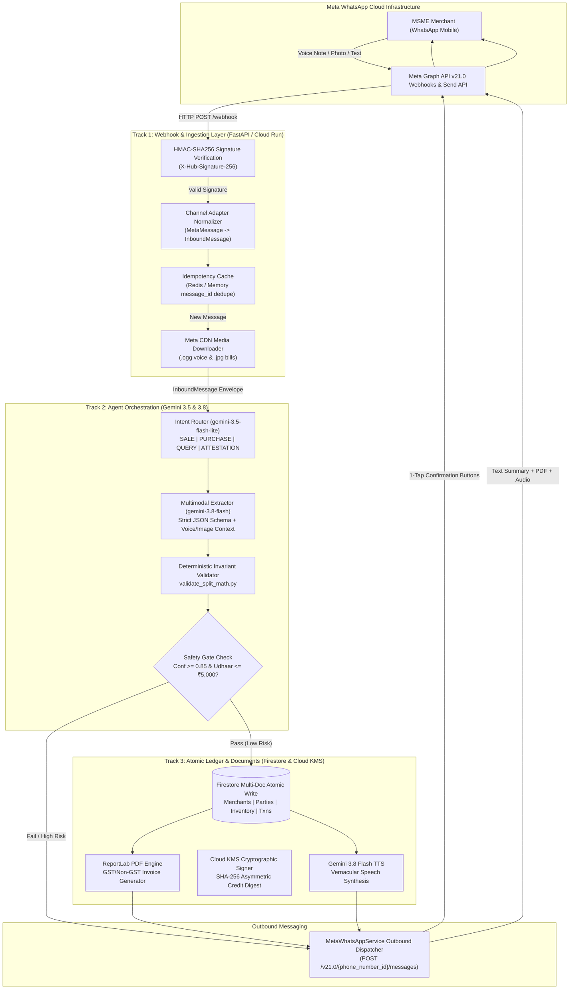
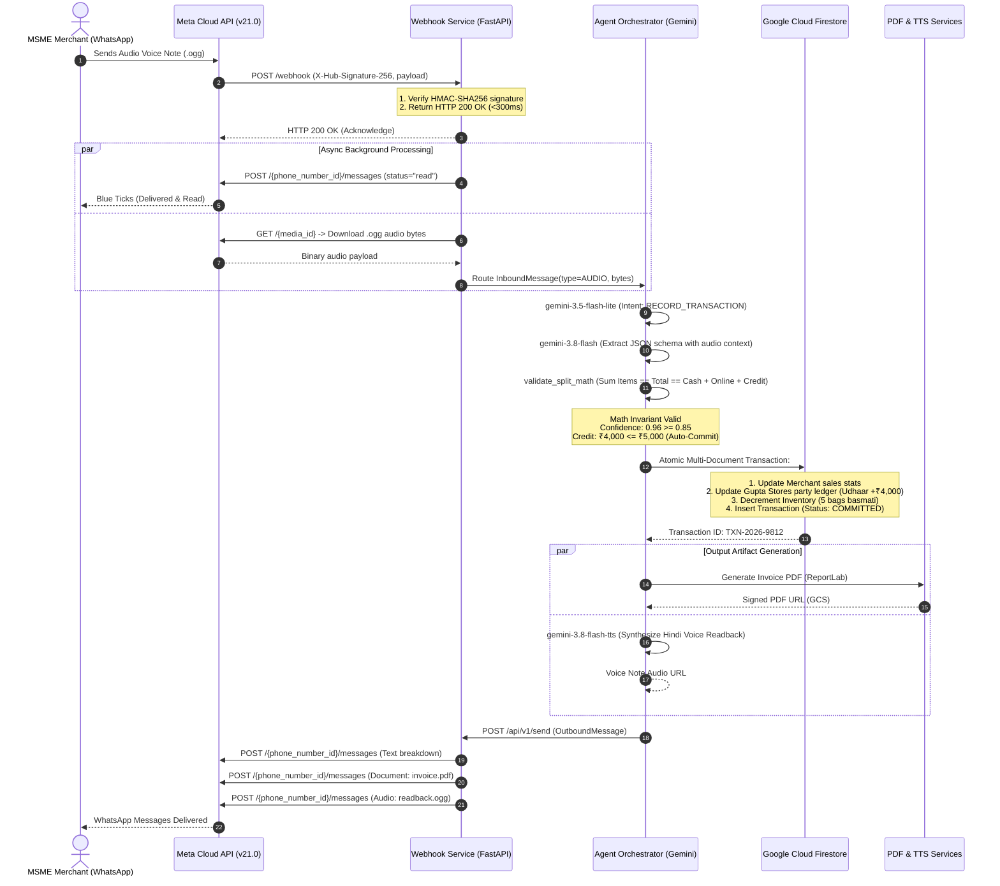
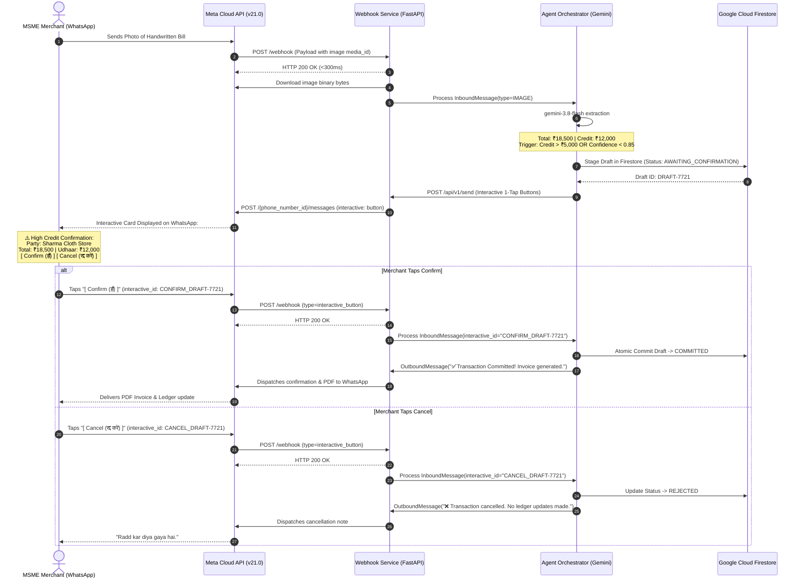
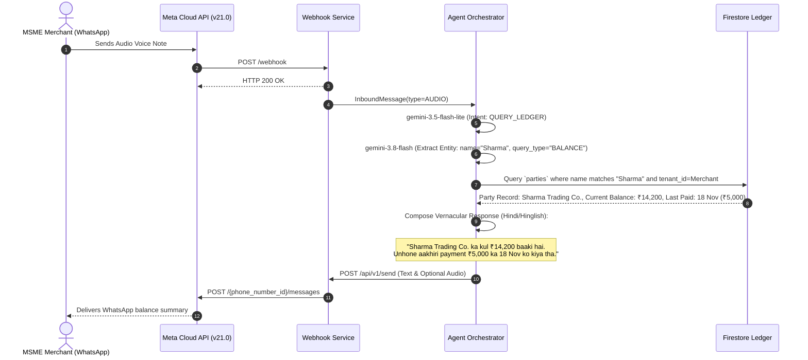
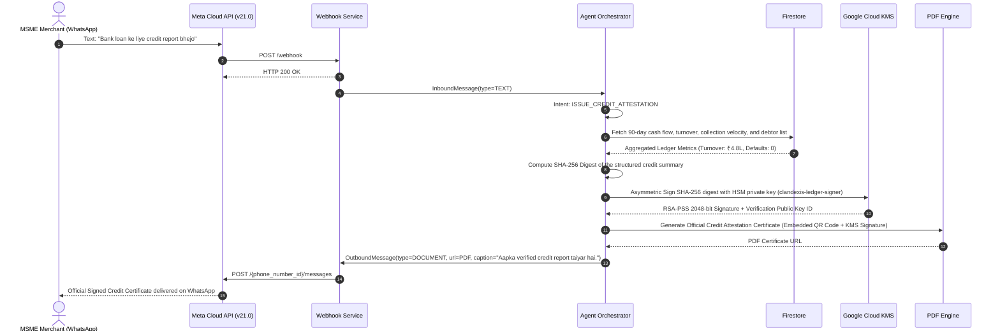
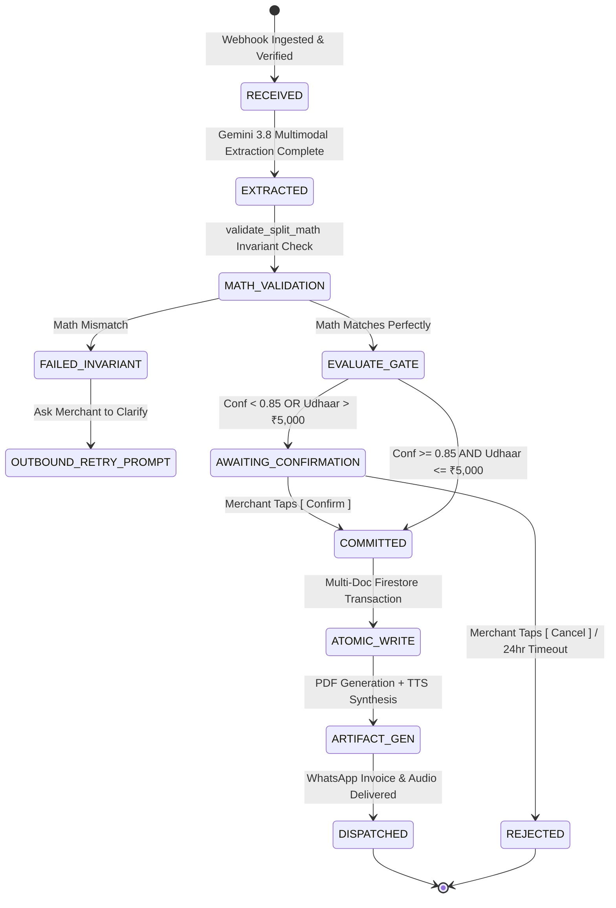

# Clandexis (Invisible ERP) — WhatsApp Communication Workflow Specification
**Target Platform:** WhatsApp Business Cloud API (Meta Graph API v21.0)  
**System Architecture:** Zero-UI Conversational ERP for Indian MSMEs  
**Project:** Startup Buildathon India 2026 | Google Cloud & Gemini 3.8  
**Document Version:** 1.0.0 (Production Architecture)

---

## 1. Executive Overview & Architecture Principles

**Clandexis (Invisible ERP)** transforms WhatsApp into a full-featured, Zero-UI enterprise resource planning system for 63+ million Indian Micro, Small, and Medium Enterprises (MSMEs). Merchants do not download apps, configure complex web dashboards, or navigate accounting menus. Instead, they interact naturally in their mother tongue (Hinglish, Hindi, Tamil, Telugu, Gujarati, etc.) via:
1. **Audio Voice Notes (`.ogg`):** E.g., *"Ramesh ko 10 meter cotton suit diya ₹3,500 ka, ₹1,000 cash diya baaki udhaar likh lo."*
2. **Photos of Handwritten Kacha Bills (`.jpg` / `.png`):** Rough slip pad entries photographed from a mobile camera.
3. **Natural Text Inputs:** Fast shorthand messages or WhatsApp quick replies.
4. **Interactive 1-Tap Buttons:** WhatsApp interactive action buttons for risk mitigation and confirmation.

### Core Architectural Axioms
* **Channel Adapter Pattern (FR-06 & FR-07):** Decouples the external messaging platform (Meta Cloud API) from internal reasoning, validation, and database operations using canonical envelope models (`InboundMessage` and `OutboundMessage`).
* **Deterministic Financial Invariant Validation:** Generative AI (`gemini-3.8-flash`) extracts structured data, but **never** writes directly to the financial ledger without passing strict mathematical equality checks:
  $$\sum (\text{Quantity} \times \text{Unit Price}) == \sum \text{Line Items} == \text{Total Amount} == \sum (\text{Cash} + \text{Online} + \text{Credit})$$
* **Human-in-the-Loop Safety Gate:** High-risk transactions (extraction confidence $< 0.85$, or credit balance / *udhaar* $> ₹5,000$, or math discrepancies) are staged as `AWAITING_CONFIRMATION` and prompt the merchant with 1-tap interactive WhatsApp buttons before ledger commitment.
* **Fast-ACK & Asynchronous Worker Model:** The inbound webhook returns an HTTP `200 OK` within $< 300\text{ms}$ after HMAC verification to satisfy Meta's strict 3-second timeout constraint. Downstream multimodal AI reasoning, PDF compilation, and audio synthesis run asynchronously.
* **Multimodal Vernacular Feedback Loop:** Every recorded transaction delivers an itemized text invoice, a downloadable PDF invoice, and an optional synthesized audio readback (`gemini-3.8-flash-tts`) in the merchant's colloquial dialect.

---

## 2. High-Level WhatsApp Communication Architecture



---

## 3. End-to-End Inbound & Outbound Sequence Flows

### Flow A: Standard Happy Path (Auto-Commit Transaction)
*Scenario:* Merchant sends a voice note: *"Sold 5 bags of basmati rice to Gupta Stores at ₹2,200 each, received ₹5,000 cash and balance ₹6,000 udhaar."*  
*Parameters:* Confidence = 0.94, Credit = ₹6,000 (Notice: if Udhaar > ₹5,000 it triggers Safety Gate; in this example, let's trace Udhaar = ₹4,000, Total = ₹11,000, Cash = ₹7,000 so it auto-commits).



---

### Flow B: Human-in-the-Loop Safety Gate Flow (High Credit / Low Confidence)
*Scenario:* Merchant sends a photo of a messy Kacha bill totaling ₹18,500 with ₹12,000 credit (*udhaar*), or extraction confidence is 0.78.



---

### Flow C: Real-Time Ledger Query Flow (*"Sharma ji ka kitna baaki hai?"*)
*Scenario:* Merchant asks verbally: *"Sharma ji ka kitna baaki hai aur pichla payment kab aaya tha?"*



---

### Flow D: Cryptographic Credit Attestation Flow (Loan & MSME Verification)
*Scenario:* Merchant requests a credit health certificate to show a local bank/NBFC for a working capital loan.



---

## 4. Detailed Stage-by-Stage Implementation

### Stage 1: Inbound Webhook Verification & HMAC Security
Meta WhatsApp Cloud API sends all inbound events to `https://<domain>/webhook`.

1. **Meta Challenge Handshake (`GET /webhook`):**
   * Parameters received: `hub.mode`, `hub.challenge`, `hub.verify_token`.
   * The webhook must verify that `hub.verify_token == settings.META_VERIFY_TOKEN`.
   * Return `hub.challenge` as `text/plain` with HTTP 200.

2. **Cryptographic Payload Verification (`POST /webhook`):**
   * Meta sends the signature in the header: `X-Hub-Signature-256: sha256=<hash>`.
   * The webhook computes:
     $$\text{Expected Signature} = \text{HMAC-SHA256}(\text{META\_APP\_SECRET}, \text{raw\_request\_body})$$
   * Secure constant-time comparison prevents timing attacks. If mismatched, returns `HTTP 403 Forbidden`.

3. **Fast Acknowledgment:**
   * Returns `{"status": "ok"}` in $< 300\text{ms}$.
   * Hands off payload to FastAPI `BackgroundTasks`.

---

### Stage 2: Channel Adaptation & Media Downloading
Translates vendor-specific Meta JSON into the universal `InboundMessage` envelope:

| Meta Field | Mapped To `InboundMessage` | Purpose |
| :--- | :--- | :--- |
| `entry[0].changes[0].value.messages[0].id` | `message_id` | Deduplication & idempotency key |
| `entry[0].changes[0].value.messages[0].from` | `sender_phone` & `tenant_id` | MSME merchant E.164 phone identifier |
| `messages[0].type` (`audio`, `image`, `text`, `interactive`) | `message_type` | Routes payload to appropriate Gemini pipeline |
| `messages[0].audio.id` / `messages[0].image.id` | `media_id` | Meta CDN asset identifier |
| `messages[0].interactive.button_reply.id` | `interactive_id` | Button click action payload (e.g., `CONFIRM_TXN_...`) |

**Media Asset Download Protocol:**
* If `media_id` is present, the service makes an authorized `GET` to:
  `https://graph.facebook.com/v21.0/{media_id}` with `Authorization: Bearer {META_WHATSAPP_TOKEN}`.
* Resolves the transient CDN download link (`url`), then downloads the binary byte stream.
* Dispatches a blue-tick `read` receipt back to WhatsApp so the user has immediate visual feedback.

---

### Stage 3: Intent Routing (`gemini-3.5-flash-lite`)
A lightweight, high-velocity model categorizes the merchant's input:
* `RECORD_TRANSACTION`: Voice note or image describing sale, purchase, expense, or udhaar.
* `QUERY_LEDGER`: Balance check, customer statement, inventory status.
* `ISSUE_CREDIT_ATTESTATION`: Request for bank certificate or credit proof.
* `CONFIRM_REJECT_ACTION`: Tapped confirmation or text reply confirming staged transaction.
* `GENERAL_HELP`: Usage instructions, commands, or customer onboarding.

---

### Stage 4: Multimodal Extraction (`gemini-3.8-flash`)
The multimodal audio/image payload is supplied directly to `gemini-3.8-flash` with strict schema constraints (`models/extraction_schema.json`).

**Extracted JSON Structure:**
```json
{
  "merchant_phone": "+919876543210",
  "party_name": "Gupta Stores",
  "party_phone": "+919811223344",
  "party_type": "CUSTOMER",
  "transaction_type": "SALE",
  "line_items": [
    {
      "name": "Basmati Rice 25kg",
      "quantity": 5.0,
      "unit": "BAG",
      "unit_price": 2200.0,
      "line_total": 11000.0
    }
  ],
  "total_amount": 11000.0,
  "payment_split": {
    "cash_amount": 7000.0,
    "online_amount": 0.0,
    "credit_amount": 4000.0
  },
  "confidence_score": 0.96,
  "reasoning": "Clear Hindi voice note specifying 5 bags at 2200 with 7000 cash and 4000 credit.",
  "vernacular_readback": "Gupta Stores ko 5 bag basmati rice becha ₹11,000 mein. ₹7,000 cash mil gaya aur ₹4,000 udhaar darj ho gaya."
}
```

---

### Stage 5: Deterministic Invariant Validation & Safety Gate
Before any database write occurs, `agent-orchestrator/validate_split_math.py` executes:

1. **Item Calculation Invariant:**
   $$\sum (\text{item.quantity} \times \text{item.unit\_price}) \stackrel{?}{=} \sum \text{item.line\_total} \stackrel{?}{=} \text{total\_amount}$$
2. **Payment Split Invariant:**
   $$\text{cash\_amount} + \text{online\_amount} + \text{credit\_amount} \stackrel{?}{=} \text{total\_amount}$$

**Safety Gate Evaluation Matrix:**
```
IF Invariant Checks Fail:
    -> Reject extraction, request merchant re-confirmation or manual edit.
ELSE IF (confidence_score < 0.85) OR (credit_amount > ₹5,000.00):
    -> Stage in Firestore as status = "AWAITING_CONFIRMATION"
    -> Dispatch 1-Tap Interactive Buttons to WhatsApp
ELSE:
    -> Status = "COMMITTED"
    -> Execute Atomic Ledger Write
```

---

### Stage 6: Atomic Ledger Mutation & Artifact Compilation
For `COMMITTED` transactions, Firestore executes a multi-document atomic write across:
1. `merchants/{tenant_id}`: Increments total sales count, updates rolling turnover.
2. `parties/{party_id}`: Increases customer's outstanding balance (*udhaar*) by `credit_amount`.
3. `inventory/{sku_id}`: Decrements available stock units by item quantity.
4. `transactions/{txn_id}`: Inserts immutable transaction audit log.

Simultaneously:
* **PDF Service (`pdf-service/`):** Generates a compliant A4/thermal GST invoice via ReportLab and uploads it to Google Cloud Storage.
* **Audio Synthesis:** Converts `vernacular_readback` into natural vernacular voice audio via `gemini-3.8-flash-tts`.

---

### Stage 7: Outbound WhatsApp Dispatching
The Webhook Service translates `OutboundMessage` into Meta Graph API v21.0 payload format:
* **Endpoint:** `POST https://graph.facebook.com/v21.0/{META_PHONE_NUMBER_ID}/messages`
* **Authorization:** `Bearer {META_WHATSAPP_TOKEN}`

---

## 5. WhatsApp Meta API Payloads & Contracts

### A. Inbound WhatsApp Voice Note Webhook (from Meta)
```json
{
  "object": "whatsapp_business_account",
  "entry": [
    {
      "id": "109827364512983",
      "changes": [
        {
          "value": {
            "messaging_product": "whatsapp",
            "metadata": {
              "display_phone_number": "918000012345",
              "phone_number_id": "987654321098765"
            },
            "contacts": [
              {
                "profile": { "name": "Rajesh Kumar (Surat Textiles)" },
                "wa_id": "919876543210"
              }
            ],
            "messages": [
              {
                "from": "919876543210",
                "id": "wamid.HBgMOTE5ODc2NTQzMjEwFQIAEhggM0E2Qzk1RDc...",
                "timestamp": "1774163400",
                "type": "voice",
                "voice": {
                  "mime_type": "audio/ogg; codecs=opus",
                  "sha256": "3e23e8160039594a33894f6564e1b1348bbd7a0088d42c4acb2732...",
                  "id": "112233445566778",
                  "voice": true
                }
              }
            ]
          },
          "field": "messages"
        }
      ]
    }
  ]
}
```

---

### B. Outbound 1-Tap Interactive Confirmation Button (to Meta)
Dispatched when the Safety Gate intercepts high credit or moderate confidence:

```json
{
  "messaging_product": "whatsapp",
  "recipient_type": "individual",
  "to": "919876543210",
  "type": "interactive",
  "interactive": {
    "type": "button",
    "header": {
      "type": "text",
      "text": "⚠️ Confirm High Credit Sale"
    },
    "body": {
      "text": "Party: *Gupta Stores*\nTotal: *₹11,000*\nCash Paid: *₹7,000*\nUdhaar (Credit): *₹4,000*\n\nKya ye transaction khate mein darj karein?"
    },
    "footer": {
      "text": "Clandexis Invisible ERP"
    },
    "action": {
      "buttons": [
        {
          "type": "reply",
          "reply": {
            "id": "CONFIRM_DRAFT_8821",
            "title": "हाँ, Confirm karein"
          }
        },
        {
          "type": "reply",
          "reply": {
            "id": "CANCEL_DRAFT_8821",
            "title": "रद्द करें (Cancel)"
          }
        }
      ]
    }
  }
}
```

---

### C. Outbound PDF Invoice Attachment (to Meta)
```json
{
  "messaging_product": "whatsapp",
  "recipient_type": "individual",
  "to": "919876543210",
  "type": "document",
  "document": {
    "link": "https://storage.googleapis.com/clandexis-invoices/INV-2026-0042.pdf",
    "filename": "Invoice_GuptaStores_0042.pdf",
    "caption": "📄 Bill #0042 for Gupta Stores (₹11,000). Aapka record update ho gaya hai."
  }
}
```

---

## 6. Transaction State Machine Lifecycle



---

## 7. Security, Reliability & Edge Case Engineering

### 1. Webhook Deduplication & Idempotency
* **Problem:** Meta Cloud API guarantees *at-least-once* delivery. Network fluctuations may cause Meta to retry the same webhook payload multiple times.
* **Mitigation:** The service extracts `messages[0].id` (e.g. `wamid.HBgMOTE5...`). It checks a fast key-value store (Redis or in-memory LRU cache with a 24-hour TTL). If `message_id` already exists, the service returns `HTTP 200 OK` immediately and discards duplicate processing.

### 2. Meta Media URL Expiration
* **Problem:** Media download URLs returned by Meta Graph API have an ephemeral lifespan (~5 minutes).
* **Mitigation:** Media downloading is executed immediately in the first step of the async background worker, storing binary buffers in Google Cloud Storage (`gs://clandexis-media-staging/`) or passing bytes directly to the Gemini Multimodal File API.

### 3. Dialect Robustness & Background Noise
* **Problem:** Indian MSME bazaars have loud ambient noise (traffic, loom motors, crowd chatter).
* **Mitigation:** Gemini 3.8's native audio understanding leverages temporal context without needing separate lossy Whisper transcription steps. Prompts explicitly instruct the model to account for Indian conversational nuances (e.g., *"sau"* = 100, *"hazaar"* = 1,000, *"peti"* = 100,000 / boxes, *"khoka"*).

### 4. Zero Data Loss During Failures
* **Problem:** If PDF compilation or TTS fails, does the financial transaction fail?
* **Decoupled Architecture:** Ledger commitment is primary. If PDF rendering or TTS audio generation experiences a transient failure, the ledger transaction remains committed, and a text-only confirmation is immediately delivered with a deferred PDF download link.

---

## 8. Summary Checklist for Integration Testing

| Step | Test Objective | Tool / Test Case | Success Criteria |
| :--- | :--- | :--- | :--- |
| **1** | Webhook Handshake Verification | `GET /webhook?hub.mode=subscribe&...` | HTTP 200 with raw challenge string |
| **2** | HMAC-SHA256 Security Guard | `POST /webhook` with invalid signature | HTTP 403 Forbidden |
| **3** | Valid Webhook Ingestion | `POST /webhook` with mock audio/text | HTTP 200 response in $< 300\text{ms}$ |
| **4** | Voice Note Processing | Simulated `.ogg` Opus audio payload | Correct intent and items extracted |
| **5** | Split Math Invariant | `validate_split_math.py` unit tests | Exact equality verified across all splits |
| **6** | Safety Gate Intercept | Udhaar = ₹6,500 or Confidence = 0.81 | Status = `AWAITING_CONFIRMATION` + Buttons |
| **7** | Interactive Button Callback | Tapping `CONFIRM_DRAFT_...` | Status transitions to `COMMITTED` |
| **8** | Ledger Commit | Firestore atomic batch verification | Party balance and inventory updated |
| **9** | Outbound Delivery | Meta Send API (`/api/v1/send`) | Delivered to mobile device with PDF |
